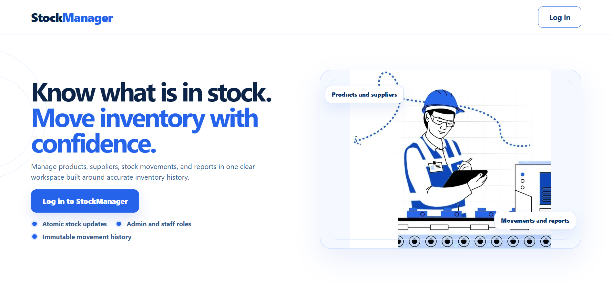
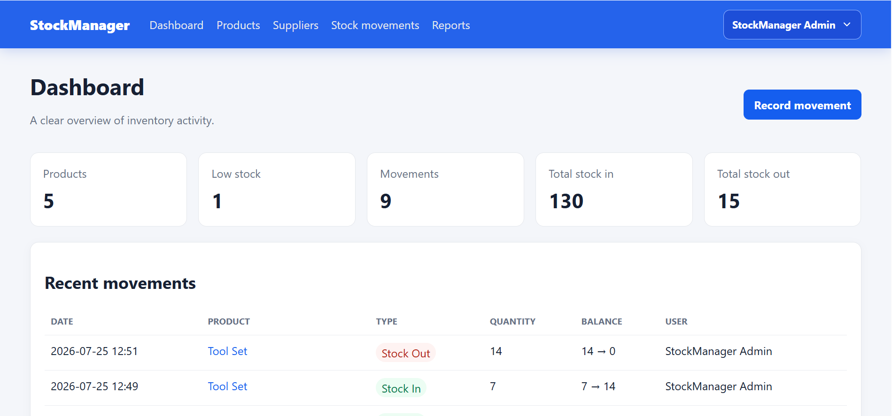
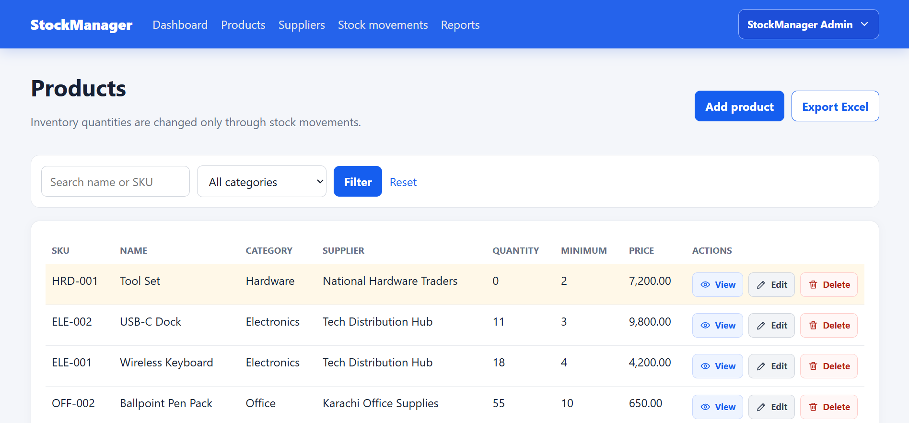
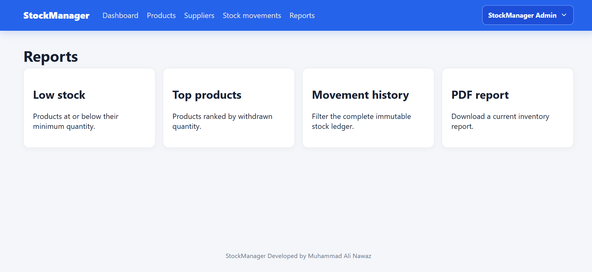

<h1 align="center">📦 StockManager</h1>

<p align="center">
  <b>A secure and responsive inventory-management system built with Laravel 12, PHP 8.2, MySQL/MariaDB, Blade, and vanilla JavaScript.</b>
</p>

<p align="center">
  Manage products and suppliers, record stock in and stock out, preserve an immutable movement ledger, generate reports, export inventory data, and access a documented REST API from one full-stack Laravel application.
</p>

<p align="center">
  
  
  
  
</p>

<p align="center">
  
  
  
  
</p>

---

## 📸 Project Screenshots

| Landing Page | Dashboard |
|---|---|
|  |  |

| Products | Reports |
|---|---|
|  |  |

---

## 🚀 Project Overview

**StockManager** is a full-stack inventory-management application for tracking products, suppliers, stock balances, stock movements, and operational reports.

The application is designed and developed by **Muhammad Ali Nawaz**. It demonstrates practical junior-to-intermediate Laravel development through secure authentication, role-based authorization, transactional inventory updates, an immutable stock ledger, server-rendered Blade pages, a Sanctum-protected REST API, exports, reporting, automated tests, and continuous integration.

Public visitors can view the responsive landing page. Authorized users can sign in and access the inventory workspace according to their assigned role. Administrators manage product and supplier metadata, while administrators and staff can view inventory and record stock movements.

---

## 🎯 Project Purpose

Inventory software must do more than provide basic CRUD pages. Stock quantities must remain accurate when multiple requests occur, historical records must not be silently rewritten, permissions must separate operational users from administrators, and reports must reflect corrected movement history.

**StockManager** brings these concerns together in one Laravel application:

- Manage products, categories, prices, suppliers, and minimum-stock levels
- Record stock-in and stock-out transactions
- Recheck available stock while the product row is locked
- Prevent negative inventory
- Preserve the complete stock movement history
- Correct mistakes through linked reversal movements instead of deletion
- Restore archived products when a valid reversal returns stock
- Display dashboard inventory metrics and recent activity
- Identify low-stock products
- Rank products by withdrawn quantity
- Export product data to Excel
- Generate downloadable PDF stock reports
- Expose a bearer-token REST API
- Document API operations through Swagger/OpenAPI
- Protect administrator-only operations through role middleware
- Seed deterministic local demonstration data safely

The project intentionally remains understandable and Laravel-native, making it suitable for a **Beginner → Intermediate Junior Laravel portfolio**.

---

## 🌟 Key Highlights

- 📦 Responsive inventory-management interface
- 🌐 Modern public landing page
- 🔐 Secure session-based web authentication
- 🔑 Sanctum personal-access-token API authentication
- 👥 Multiple users with Admin and Staff roles
- 🚫 Public registration intentionally disabled
- 🛡️ Role-protected web and API routes
- 🧾 Product and supplier management
- ➕ Stock-in workflow
- ➖ Stock-out workflow with insufficient-stock prevention
- 🔒 Database transactions and row-level locking
- 📚 Immutable stock movement ledger
- ↩️ Linked stock movement reversals
- 🗃️ Product soft deletion and archived-history support
- ⚠️ Low-stock monitoring
- 📊 Dashboard inventory statistics
- 📈 Top-withdrawn-product reporting
- 🔎 Filterable movement history
- 📄 PDF inventory reports
- 📑 Excel product exports
- 🧪 Unit, feature, presentation, authorization, and integrity tests
- 🎨 Laravel Pint formatting checks
- 🔍 Composer and NPM security audits
- 📘 Swagger/OpenAPI documentation
- ⚙️ GitHub Actions CI with SQLite and MySQL jobs

---

## ✨ Features

### 🌐 Public Landing Page

| Feature | Description |
|---|---|
| Responsive Hero | Full-viewport landing experience for desktop, tablet, and mobile screens |
| Existing Branding | Uses the StockManager wordmark and the application's established navigation |
| Clear Access Path | Direct sign-in action for authorized users |
| Blue and White UI | Consistent professional visual system without unrelated branding |
| Mobile Navigation | Responsive navigation controlled with lightweight JavaScript |

---

### 🔐 Authentication and Account Security

| Feature | Description |
|---|---|
| Login and Logout | Secure Laravel session authentication for the web interface |
| Password Hashing | Passwords are stored through Laravel's secure hashing system |
| Remember Me | Optional persistent login through Laravel's remember-token support |
| Password Visibility | Login password remains hidden by default and can be toggled by the user |
| Session Regeneration | Successful login regenerates the session to reduce fixation risk |
| Login Throttling | Repeated login attempts are limited by route throttling |
| CSRF Protection | Laravel CSRF protection remains enabled for web forms |
| Guest Redirects | Unauthenticated users are redirected to the login page for protected areas |
| No Public Registration | Accounts are provisioned from a trusted terminal instead of an open registration form |

Create an additional authorized account with:

```bash
php artisan stockmanager:create-user
```

The command validates the name, email, password, and role; rejects duplicate email addresses; requires a password of at least 12 characters; and never prints the password.

---

### 📊 Dashboard Features

| Feature | Description |
|---|---|
| Product Count | Displays the number of active products |
| Low-Stock Count | Displays products at or below their configured minimum quantity |
| Movement Count | Displays the complete stock movement count |
| Stock-In Total | Displays the total quantity recorded as stock in |
| Stock-Out Total | Displays the total quantity recorded as stock out |
| Recent Activity | Shows recent product movements, quantities, balances, and responsible users |
| User Dropdown | Displays the signed-in user's name and a protected sign-out action |

---

### 📦 Product Features

| Feature | Description |
|---|---|
| Product Listing | Paginated product inventory with quantity and supplier information |
| Product Details | Displays inventory information and related movement history |
| Create Product | Administrator-only product creation with validated opening stock |
| Edit Product | Administrator-only metadata updates |
| Quantity Integrity | Product quantity cannot be changed through the normal edit endpoint |
| Minimum Quantity | Configurable threshold used by low-stock reports |
| Supplier Relationship | Products can be associated with a supplier |
| Soft Deletion | Zero-stock products can be archived without destroying historical movements |
| Stock Protection | Products with nonzero stock cannot be archived |
| Excel Export | Authorized users can download product inventory data |
| Formula Safety | Exported user-controlled values are protected against spreadsheet formulas |

---

### 🏭 Supplier Features

| Feature | Description |
|---|---|
| Supplier Listing | Paginated supplier directory |
| Supplier Details | Displays contact information and associated products |
| Create Supplier | Administrator-only supplier creation |
| Edit Supplier | Administrator-only supplier updates |
| Delete Supplier | Administrator-only deletion where relationship rules allow it |
| Contact Fields | Supports name, email, phone number, and address |

---

### 🔄 Stock Movement Features

| Feature | Description |
|---|---|
| Stock In | Adds inventory and records the previous and updated balance |
| Stock Out | Removes inventory only when sufficient stock is available |
| Opening Stock | Initial product quantity is recorded as a normal ledger movement |
| Immutable History | Existing movement records cannot be edited or deleted |
| Movement Details | Displays product, user, type, quantity, balance transition, note, and correction link |
| Reversal Workflow | Administrators correct a movement by creating a linked opposite movement |
| Duplicate-Reversal Prevention | A movement can be reversed only once |
| Archived Product Recovery | Reversing a withdrawal can restore an archived product when stock becomes positive |
| Responsible User | Every movement records the authenticated user who performed it |
| Notes | Optional explanatory notes can be stored with a movement |

A balance such as `7 → 14` means the product quantity was 7 before the movement and 14 after it.

---

### 📈 Reporting and Export Features

| Feature | Description |
|---|---|
| Low-Stock Report | Lists products whose quantity is at or below the minimum threshold |
| Top Products | Ranks products by valid withdrawn quantity |
| Movement History | Provides a filterable view of the immutable ledger |
| PDF Report | Downloads a current product inventory report |
| Excel Export | Downloads product data in spreadsheet format |
| Reversal-Aware Totals | Reversed withdrawals are excluded from top-product calculations |
| Date Filters | PDF and API report endpoints support validated date filters |

---

### 📡 REST API Features

| Feature | Description |
|---|---|
| Token Login | Creates a Sanctum personal access token from valid credentials |
| Token Logout | Revokes the current personal access token |
| Authenticated User | Returns the signed-in API user's identity and roles |
| Product API | Paginated product read operations for Admin and Staff; mutations for Admin |
| Supplier API | Read operations for Admin and Staff; mutations for Admin |
| Stock API | Stock-in and stock-out operations for Admin and Staff |
| Movement Reversal API | Administrator-only reversal endpoint |
| Reports API | Low stock, top products, history, PDF, and Excel access |
| Consistent Resources | Laravel API Resources provide stable response envelopes |
| Swagger UI | Interactive API documentation generated with L5-Swagger |

Swagger UI is available after generation at:

```text
http://127.0.0.1:8000/api/documentation
```

---

## 👥 Access Model

The application supports multiple users and uses **Spatie Laravel Permission** for role-based access.

| Persona | Access Level |
|---|---|
| 👑 Administrator | Full inventory access; manages products and suppliers; records stock; reverses movements; views reports and exports |
| 🧑‍💼 Staff | Views products, suppliers, movements, and reports; records stock in and stock out; cannot manage product/supplier metadata or reverse movements |
| 🔒 Authenticated User Without Role | Denied access to the protected inventory workspace |
| 🌐 Visitor | Views the public landing page and login page only |

A Manager role is not implemented. The supported roles are `admin` and `staff`.

---

## 🛠 Technology Stack

| Layer | Technologies |
|---|---|
| Backend | PHP 8.2+, Laravel 12 |
| Web Frontend | Blade templates, HTML5, custom CSS, vanilla JavaScript |
| Database | MySQL or MariaDB |
| ORM | Laravel Eloquent models, relationships, scopes, factories, and soft deletes |
| Web Authentication | Laravel session authentication |
| API Authentication | Laravel Sanctum personal access tokens |
| Authorization | Spatie Laravel Permission roles and middleware |
| Business Logic | Shared Laravel service layer with database transactions |
| Concurrency Control | MySQL row locking through `lockForUpdate()` |
| Excel Export | Maatwebsite Laravel Excel / PhpSpreadsheet |
| PDF Generation | Laravel DomPDF |
| API Documentation | L5-Swagger, Swagger-PHP, OpenAPI, Swagger UI |
| Testing | PHPUnit 11 and Laravel testing utilities |
| Code Style | Laravel Pint |
| Asset Build | Node.js custom asset-build script and NPM |
| CI | GitHub Actions with SQLite and MySQL jobs |
| Package Management | Composer and NPM |
| Local Environment | XAMPP, Laragon, WAMP, Docker, or equivalent PHP/MySQL environment |

---

## 🏗 Architecture Overview

The project follows Laravel MVC conventions and keeps stock-changing logic in one shared service so the web interface and REST API obey the same business rules.

```text
Browser or API Client
        ↓
Laravel Route
        ↓
Authentication Middleware
        ↓
Role Middleware
        ↓
Controller + Request Validation
        ↓
StockService / Eloquent Operations
        ↓
Database Transaction + Row Lock
        ↓
Product Balance + Stock Movement Ledger
        ↓
Blade Response or JSON API Resource
```

### Main Application Structure

```text
stockmanager-laravel/
├── app/
│   ├── Console/Commands/
│   ├── Events/
│   ├── Exports/
│   ├── Http/
│   │   ├── Controllers/
│   │   ├── Requests/
│   │   └── Resources/
│   ├── Models/
│   ├── OpenApi/
│   ├── Providers/
│   └── Services/
├── bootstrap/
├── config/
├── database/
│   ├── factories/
│   ├── migrations/
│   └── seeders/
├── docs/
│   └── screenshots/
├── public/
│   └── images/
├── resources/
│   ├── css/
│   ├── js/
│   └── views/
├── routes/
│   ├── api.php
│   ├── console.php
│   └── web.php
├── scripts/
├── storage/
├── tests/
│   ├── Feature/
│   └── Unit/
├── .github/workflows/ci.yml
├── .env.example
├── composer.json
├── package.json
└── README.md
```

---

## 🔄 Application Flows

### Stock-In Flow

```text
Authorized User Opens Record Movement
        ↓
Select Product and Stock In
        ↓
Validate Quantity and Note
        ↓
Start Database Transaction
        ↓
Reload Product with Row Lock
        ↓
Calculate Updated Quantity
        ↓
Update Product and Create Ledger Movement
        ↓
Commit Transaction
        ↓
Display Updated Inventory Balance
```

### Stock-Out Flow

```text
Authorized User Requests Stock Out
        ↓
Validate Product and Quantity
        ↓
Start Database Transaction
        ↓
Reload Product with Row Lock
        ↓
Recheck Available Quantity
        ↓
Reject Request if Balance Would Become Negative
        ↓
Update Product and Create Ledger Movement Atomically
        ↓
Commit Transaction
```

### Movement Correction Flow

```text
Administrator Opens Movement Details
        ↓
Enter Correction Reason
        ↓
Lock Original Movement
        ↓
Reject if Already Reversed
        ↓
Lock Active or Archived Product
        ↓
Calculate Opposite Movement
        ↓
Reject if Correction Would Make Stock Negative
        ↓
Restore Archived Product When Required
        ↓
Create Linked Reversal Without Deleting History
```

### Product Archive Flow

```text
Administrator Opens Product
        ↓
Request Archive
        ↓
Verify Product Quantity Is Zero
        ↓
Soft Delete Product
        ↓
Keep Historical Movement Relationships Available
```

---

## 🗄 Database Overview

The application uses Laravel migrations with MySQL or MariaDB for local and production-like use. SQLite is used by the primary CI test job, while a second GitHub Actions job verifies the MySQL locking path.

### Main Tables

| Table | Purpose |
|---|---|
| `users` | Stores user identity, credentials, verification timestamp, and remember token |
| `roles` | Stores Admin and Staff role definitions |
| `permissions` | Supports Spatie permission infrastructure |
| `model_has_roles` | Associates users with roles |
| `model_has_permissions` | Supports direct permission associations |
| `role_has_permissions` | Associates permissions with roles |
| `suppliers` | Stores supplier identity and contact details |
| `products` | Stores product metadata, quantity, price, minimum quantity, supplier, category, and soft-delete state |
| `stock_movements` | Stores immutable stock-in/out history, balance transitions, user, note, and reversal relationship |
| `personal_access_tokens` | Stores Sanctum API tokens |
| `sessions` | Stores database-backed web sessions |
| `cache` / `cache_locks` | Supports database-backed Laravel cache operations |
| `jobs` / `failed_jobs` | Supports Laravel queue infrastructure |

### Data Integrity

- Product SKU values are unique
- User email addresses are unique
- Product quantity cannot be negative
- Stock movement quantity must be positive
- Movement balance before and after is stored explicitly
- Every movement belongs to a product and user
- A reversal relationship is unique
- Foreign keys protect related records
- Product deletion uses soft deletes
- Products with stock cannot be archived
- Product quantity changes are centralized in `StockService`
- Transactions update product balances and ledger records atomically
- Row locks protect the availability check on MySQL

---

## 🔐 Security Implementations

| Security Area | Implementation |
|---|---|
| Web Authentication | Laravel session authentication with regenerated sessions |
| API Authentication | Sanctum bearer tokens; web sessions are not accepted by protected API routes |
| Password Storage | Laravel hashing and password casts |
| Login Protection | Route throttling limits repeated login attempts |
| CSRF Protection | Standard Laravel CSRF middleware protects browser mutations |
| Role Authorization | Admin and Staff middleware on web and API routes |
| Administrator Boundaries | Product/supplier mutations and reversals are Administrator-only |
| Stock Integrity | Transactions, row locks, in-transaction availability checks, and rollback safety |
| Immutable Ledger | Historical movements cannot be edited or deleted |
| Safe Corrections | Linked reversal records preserve the audit history |
| Mass Assignment | Models use controlled fillable/guarded behavior |
| Request Validation | Form Requests and controller validation protect incoming data |
| Spreadsheet Safety | Formula-like text is neutralized during Excel export |
| Soft-Delete Safety | Archived products remain accessible through historical movement relationships |
| Seeder Safety | Demo seeding is rejected outside `local` and `testing` |
| Explicit Seeder Opt-In | `ALLOW_DEMO_SEEDING=true` is required |
| Strong Demo Password | `DEMO_PASSWORD` must be explicitly supplied and at least 12 characters |
| Environment Protection | `.env`, local databases, logs, caches, and generated files are excluded from Git |

---

## ⚡ Performance and Code Quality

- Uses eager loading where related products, suppliers, and users are rendered
- Uses pagination for inventory and movement listings
- Uses database aggregation for dashboard and report totals
- Uses a shared service for stock-changing behavior
- Uses database transactions with retry support
- Uses MySQL row locking for stock consistency
- Dispatches stock-level events after a successful commit
- Uses Laravel API Resources for JSON output
- Uses Blade layouts and reusable partials for server-rendered pages
- Uses custom CSS and lightweight JavaScript without unnecessary frontend frameworks
- Uses PHPUnit feature tests for authentication, roles, seeders, stock integrity, exports, UI rendering, and API contracts
- Uses Laravel Pint for consistent PHP formatting
- Uses Composer and NPM dependency audits
- Uses GitHub Actions for repeatable verification

---

## 📡 Main Routes and System Areas

| Area | Purpose |
|---|---|
| `/` | Public StockManager landing page |
| `/login` | Authorized user login |
| `/dashboard` | Inventory metrics and recent movements |
| `/products` | Product inventory list |
| `/products/{product}` | Product details and movement history |
| `/products/export` | Excel inventory export |
| `/suppliers` | Supplier directory |
| `/suppliers/{supplier}` | Supplier details and associated products |
| `/stock-movements` | Complete movement list |
| `/stock-movements/create` | Record stock in or stock out |
| `/stock-movements/{movement}` | Movement details and eligible reversal action |
| `/reports` | Report navigation |
| `/reports/low-stock` | Low-stock products |
| `/reports/top-products` | Products ranked by withdrawn quantity |
| `/reports/history` | Filterable stock movement history |
| `/reports/stock/pdf` | PDF inventory report |
| `/api/login` | API token login |
| `/api/products` | Authenticated product API |
| `/api/suppliers` | Authenticated supplier API |
| `/api/stock/in` | Authenticated stock-in API |
| `/api/stock/out` | Authenticated stock-out API |
| `/api/reports/*` | Authenticated report API |
| `/api/documentation` | Swagger UI |

---

## ⚙️ Installation Guide

### Requirements

- PHP 8.2 or higher
- Composer 2
- Node.js 20 or higher and NPM
- MySQL or MariaDB
- Git
- Required PHP extensions: `mbstring`, `fileinfo`, `openssl`, `pdo_mysql`, `pdo_sqlite`, `sqlite3`, `dom`, `xml`, `xmlreader`, `xmlwriter`, `zip`, and `gd`
- XAMPP, Laragon, WAMP, Docker, or an equivalent PHP/MySQL environment

---

### 1️⃣ Clone the Repository

```bash
git clone https://github.com/YOUR_GITHUB_USERNAME/stockmanager-laravel.git
cd stockmanager-laravel
```

---

### 2️⃣ Install PHP Dependencies

```bash
composer install --prefer-dist
```

---

### 3️⃣ Install Frontend Dependencies

```bash
npm ci
```

The frontend uses a small custom Node asset-build script and does not require React, Vue, Angular, Tailwind CSS, Bootstrap, or jQuery.

---

### 4️⃣ Create the Environment File

Windows PowerShell:

```powershell
Copy-Item .env.example .env
```

Windows Command Prompt:

```bat
copy .env.example .env
```

macOS/Linux:

```bash
cp .env.example .env
```

---

### 5️⃣ Generate the Application Key

```bash
php artisan key:generate
```

---

### 6️⃣ Create the Database

Example MySQL or MariaDB database:

```sql
CREATE DATABASE stockmanager
    CHARACTER SET utf8mb4
    COLLATE utf8mb4_unicode_ci;
```

Update `.env`:

```env
APP_NAME="StockManager"
APP_ENV=local
APP_DEBUG=true
APP_URL=http://127.0.0.1:8000
APP_TIMEZONE=Asia/Karachi

DB_CONNECTION=mysql
DB_HOST=127.0.0.1
DB_PORT=3306
DB_DATABASE=stockmanager
DB_USERNAME=root
DB_PASSWORD=

ALLOW_DEMO_SEEDING=true
DEMO_NAME="StockManager Admin"
DEMO_EMAIL=admin@example.com
DEMO_PASSWORD=StockManagerLocal@2026
```

> The sample password above is intended only for local demonstration. Never reuse it for a deployed application or another account.

Never commit the real `.env` file.

---

### 7️⃣ Run Migrations and Optional Demo Seeding

Create an empty database without demo data:

```bash
php artisan migrate
```

Create the local demonstration inventory:

```bash
php artisan migrate:fresh --seed
```

> `migrate:fresh` deletes all tables and records in the configured database. Use it only with a disposable local database.

Demo seeding succeeds only when:

- `APP_ENV` is `local` or `testing`
- `ALLOW_DEMO_SEEDING=true`
- `DEMO_PASSWORD` contains at least 12 characters

Production and staging are rejected even when the opt-in flag is enabled.

---

### 8️⃣ Create the Public Storage Link

```bash
php artisan storage:link
```

---

### 9️⃣ Build Frontend Assets

Production build:

```bash
npm run build
```

Development watch mode:

```bash
npm run dev
```

---

### 🔟 Generate Swagger Documentation

```bash
php artisan l5-swagger:generate
```

---

### 1️⃣1️⃣ Start the Laravel Application

```bash
php artisan serve --host=127.0.0.1 --port=8000
```

Open:

```text
http://127.0.0.1:8000
```

The Laravel server serves both the Blade frontend and backend application.

---

## 🔑 Demo Login Credentials

After configuring the sample local `.env` values and running the guarded demo seeder:

```text
Email:    admin@example.com
Password: StockManagerLocal@2026
Role:     Admin
```

The demo account is local-only and must never be treated as a production credential.

Create more Admin or Staff users with:

```bash
php artisan stockmanager:create-user
```

---

## 🔌 API Authentication Example

Create a token:

```bash
curl -X POST http://127.0.0.1:8000/api/login \
  -H "Accept: application/json" \
  -H "Content-Type: application/json" \
  -d '{"email":"admin@example.com","password":"StockManagerLocal@2026","device_name":"local-client"}'
```

Use the returned bearer token:

```bash
curl http://127.0.0.1:8000/api/products \
  -H "Accept: application/json" \
  -H "Authorization: Bearer YOUR_TOKEN"
```

Revoke the current token:

```bash
curl -X POST http://127.0.0.1:8000/api/logout \
  -H "Accept: application/json" \
  -H "Authorization: Bearer YOUR_TOKEN"
```

---

## 🧪 Testing and Verification

Run the complete Laravel test suite:

```bash
php artisan test
```

Run the MySQL stock concurrency tests against a disposable test database:

```bash
php artisan test --filter=StockConcurrencyTest
```

Check PHP formatting:

```bash
./vendor/bin/pint --test
```

Windows PowerShell:

```powershell
.\vendor\bin\pint.bat --test
```

Compile frontend assets:

```bash
npm run build
```

Validate Composer metadata:

```bash
composer validate --strict
```

Verify PHP requirements:

```bash
composer check-platform-reqs
```

Audit PHP dependencies:

```bash
composer audit --locked --abandoned=report --no-interaction
```

Audit frontend dependencies:

```bash
npm audit --audit-level=high
```

Generate the OpenAPI documentation:

```bash
php artisan l5-swagger:generate
```

### Verified Runtime Evidence

The project has been verified locally with:

- Complete core Laravel suite passing with 44 tests and 180 assertions before the final presentation-test additions
- MySQL stock-concurrency suite passing with 2 tests and 6 assertions
- Laravel Pint passing across 78 PHP files at the verified baseline
- Composer audit reporting no security vulnerability advisories
- NPM audit reporting zero vulnerabilities
- Frontend production asset build completing successfully
- Database migrations and guarded demo seeding completing successfully
- Swagger UI and application routes loading successfully

The repository now includes additional frontend presentation and detail-page rendering tests. Run `php artisan test` before each release to obtain and publish the current total.

---

## 🔁 Continuous Integration

The GitHub Actions workflow runs on every push and pull request.

The primary CI job verifies:

- Composer metadata
- PHP dependency installation
- PHP platform requirements
- Composer security audit
- SQLite database preparation
- Migrations and guarded demo seeding
- Complete Laravel test suite
- Laravel Pint formatting
- NPM dependency installation
- Frontend production build
- NPM security audit
- Swagger/OpenAPI generation

A dedicated MySQL job verifies:

- MySQL 8.4 service startup
- MySQL migrations
- Real MySQL row-locking configuration
- `StockConcurrencyTest`

Workflow file:

```text
.github/workflows/ci.yml
```

---

## 🏗 Production Build and Deployment Checklist

Recommended production values:

```env
APP_ENV=production
APP_DEBUG=false
APP_URL=https://your-domain.example
ALLOW_DEMO_SEEDING=false
DEMO_PASSWORD=
SESSION_SECURE_COOKIE=true
```

Install optimized backend dependencies:

```bash
composer install --no-dev --optimize-autoloader --no-interaction
```

Build frontend assets:

```bash
npm ci
npm run build
```

Run migrations:

```bash
php artisan migrate --force
```

Create the storage link:

```bash
php artisan storage:link
```

Generate API documentation when it is exposed in the deployment:

```bash
php artisan l5-swagger:generate
```

Cache Laravel configuration and routes:

```bash
php artisan optimize
```

Additional production requirements:

- Configure Nginx or Apache with `public/` as the document root
- Use HTTPS
- Configure unique database credentials
- Keep `APP_DEBUG=false`
- Disable demo seeding
- Do not expose local demonstration credentials
- Configure filesystem permissions for `storage/` and `bootstrap/cache/`
- Configure backups, monitoring, error reporting, and log rotation
- Use a persistent queue worker when asynchronous jobs are enabled
- Never commit `.env`, `vendor`, `node_modules`, logs, caches, local databases, or generated public storage links

---

## 📁 Repository Files to Keep

The following project files are intentionally committed:

- Application source under `app/`, `resources/`, `routes/`, and `config/`
- Migrations, seeders, and factories under `database/`
- Automated tests under `tests/`
- GitHub Actions workflow under `.github/`
- Screenshot documentation under `docs/screenshots/`
- `composer.json` and `composer.lock`
- `package.json` and `package-lock.json`
- `.env.example`
- `StockManager_OpenAPI.json`
- `README.md`, `SECURITY.md`, `NOTICE.md`, and `LICENSE`

Generated dependencies, caches, logs, environment secrets, compiled frontend assets, test result caches, local databases, and temporary backup folders are excluded.

---

## ✅ Portfolio Verification Checklist

- [x] Laravel 12 MVC structure
- [x] Responsive Blade frontend
- [x] Public landing page
- [x] Secure login and logout
- [x] Password visibility control
- [x] Multiple users
- [x] Admin and Staff roles
- [x] Product CRUD with authorization
- [x] Supplier CRUD with authorization
- [x] Stock-in and stock-out workflows
- [x] Negative-stock prevention
- [x] Database transactions
- [x] MySQL row locking
- [x] Immutable stock ledger
- [x] Linked reversal workflow
- [x] Product soft deletion
- [x] Archived-product movement history
- [x] Dashboard statistics
- [x] Low-stock report
- [x] Top-products report
- [x] Movement history filters
- [x] Excel export
- [x] PDF report
- [x] Sanctum bearer-token API
- [x] Swagger/OpenAPI documentation
- [x] Guarded local/testing demo seeding
- [x] Secure terminal user creation
- [x] Automated unit and feature tests
- [x] Frontend presentation tests
- [x] Detail-page rendering tests
- [x] Laravel Pint verification
- [x] Composer and NPM audits
- [x] GitHub Actions CI
- [x] MySQL stock-integrity CI job
- [x] Screenshot documentation
- [x] Repository cleanup and ignore rules

---

## 👨‍💻 Author and Owner

**Muhammad Ali Nawaz**  
PHP / Laravel Developer  
Karachi, Pakistan

StockManager is fully owned and developed by Muhammad Ali Nawaz.

---

## 📄 License

Copyright © 2026 **Muhammad Ali Nawaz**.

This project is open-source software licensed under the [MIT License](LICENSE). Muhammad Ali Nawaz remains the sole copyright owner while granting the permissions described in the license.

---

<p align="center">
  <b>⭐ If you find StockManager useful, consider starring the repository!</b>
</p>
